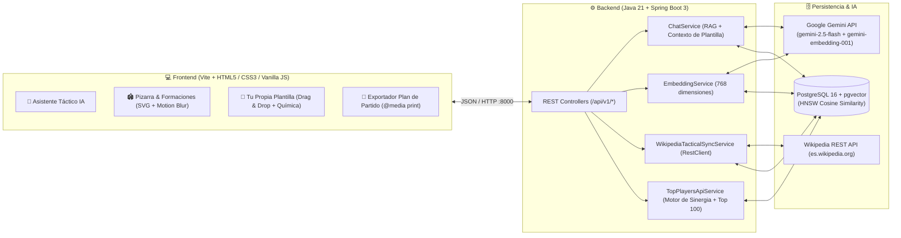

# ⚽ TacticalPlay RAG — Entrenador Táctico IA & Pizarra Vectorial


**TacticalPlay RAG** es una plataforma integral de dirección técnica deportiva que fusiona **Retrieval-Augmented Generation (RAG)** sobre base de datos vectorial con un **Simulador Posicional Interactivo** y un **Motor de Sinergia y Química de Plantillas**.

Diseñada para entrenadores, analistas y cuerpos técnicos, adapta su motor táctico, sus formaciones, sus jugadas preparadas y su razonamiento en tiempo real a **4 modalidades deportivas**:
- ⚡ **Futsal (5 vs 5)** — Pista de 40×20m, rotaciones, portero-jugador y bloqueos.
- 🛡️ **Fútbol 7 (7 vs 7)** — Amplitud con carrileros, superioridad por zona y transiciones rápidas.
- 🎯 **Fútbol 9 (9 vs 9)** — Etapa puente formativa hacia campo completo, basculaciones y triángulos interiores.
- 🏟️ **Fútbol 11 (11 vs 11)** — Ocupación racional de los 5 carriles, presión tras pérdida y balón parado avanzado.

---

## 🏗️ Arquitectura Tecnológica & Stack



### Stack Principal
- **Backend:** Java 21 + Spring Boot 3 (`Spring Web`, `Spring JDBC / Data`, `RestClient` con timeouts estrictos para integración con **Google Gemini** y **Wikipedia API**).
- **Base de Datos Vectorial:** **PostgreSQL 16 + `pgvector`** con índice `HNSW` (`vector_cosine_ops`), almacenando embeddings de **768 dimensiones** generados con `gemini-embedding-001`, catálogo **Top 100 Mundial/Histórico** y plantillas personalizadas (`custom_players`). Limpieza automática en el arranque (`WebAndDatabaseConfig`) de registros residuales ajenos al dominio deportivo.
- **IA Generativa:** **Google Gemini (`gemini-2.5-flash`)** con *System Prompt* especializado en lenguaje claro y directo de entrenador de cancha, enriquecido dinámicamente con la modalidad, formación, estilo de juego, fragmentos vectoriales recuperados y la plantilla real registrada por el usuario.
- **Frontend Modular + Motor GSAP Broadcast:** HTML5 semántico, CSS3 (**Glassmorphism Dark Mode Violeta/Neón** con `backdrop-filter: blur(12px)`, `CSS Grid` responsivo, hoja ejecutiva `@media print` para exportación a PDF) y **JavaScript Vanilla (ES6 Modules)** estructurado en 4 capas desacopladas:
  - `src/services/api.js`: Cliente HTTP centralizado hacia los controladores REST de Spring Boot (`:8000`).
  - `src/store/tacticalStore.js`: Gestor de estado reactivo ligero (`Pub/Sub`), registro DOM y catálogos tácticos.
  - `src/engine/pitchEngine.js`: Motor gráfico SVG/DOM con **GSAP (GreenSock)** — física de resortes (`elastic.out` / `back.out`) con *stagger* escalonado por línea táctica (`POR ➔ DEF ➔ MED ➔ DEL`), trayectorias curvas **Bézier** con estelas luminosas (*Motion Trails*), cámara de transmisión **🎥 Vista TV 2.5D** con *billboarding inverso*, zonas de influencia (auras de Visión + triángulos de pase dinámicos en *hover*) y superficies adaptativas (**Césped Broadcast** para Fútbol 7/9/11 y **Duela Sintética** para Futsal).
  - `src/ui/` (`chatView.js`, `pitchView.js`, `squadView.js`): Controladores de vista para las 3 pestañas, conexión directa **`▶ Reproducir en Pizarra`** desde las respuestas del bot IA y **Gráfico de Radar Hexagonal SVG** animado con GSAP que superpone los 6 atributos del jugador frente a su referente del **Top 100 Mundial/Histórico**.

---

## 🧩 Módulos Principales

### 1. 🤖 Asistente Táctico IA
- **Chat con Lenguaje de Vestuario:** Respuestas estructuradas, directas y aplicables al entrenamiento o partido, sin jerga académica innecesaria.
- **Búsqueda Semántica Híbrida (`pgvector` + `Wikipedia API`):** Recupera contexto táctico indexado por deporte (`futsal`, `futbol7`, `futbol9`, `futbol11`, `api-externa`) mediante similitud coseno.
- **Conciencia Total del Contexto Activo:** Conoce en todo momento qué modalidad, formación, estilo de juego y jugadores reales componen la plantilla del entrenador para sugerir alineaciones, ajustes y cambios desde la banca.

### 2. 🏟️ Pizarra & Formaciones
- **Catálogo de 30 Sistemas Tácticos:**
  - **Futsal (7):** `1-3-1 (Rombo)`, `1-2-2 (Cuadrado)`, `1-4-0 (Sistema Plano)`, `1-1-2-1 (Pirámide)`, `1-2-1-1 (Y Invertida)`, `5-0 (Portero-Jugador)` y `1-3-1 (Presión Alta)`.
  - **Fútbol 7 (7):** `1-2-3-1`, `1-3-2-1 (Árbol)`, `1-2-1-2-1 (Rombo)`, `1-3-1-2`, `1-2-2-2`, `1-3-3 (Ofensivo)` y `1-4-1-1 (Bloque Bajo)`.
  - **Fútbol 9 (7):** `1-3-3-2`, `1-4-3-1`, `1-3-4-1`, `1-3-2-3`, `1-4-2-2`, `1-3-5-0 (Falso 9)` y `1-4-1-3`.
  - **Fútbol 11 (9):** `1-4-3-3`, `1-4-2-3-1`, `1-3-5-2`, `1-4-4-2 (Clásico)`, `1-4-4-2 (Rombo)`, `1-3-4-3`, `1-4-1-4-1`, `1-4-3-2-1 (Árbol de Navidad)` y `1-5-3-2 (Bloque Bajo)`.
- **5 Estilos de Juego Dinámicos:** *Posesión & Juego de Posición*, *Presión Alta (Gegenpressing)*, *Bloque Bajo & Contragolpe*, *Juego Directo & Vertical* y *Rotación Dinámica*, que modifican en vivo la altura y amplitud de las líneas sobre la cancha.
- **Tarjeta de DT Referente:** Muestra el entrenador histórico o actual modelo para cada combinación de formación y estilo (Guardiola, Klopp, Ancelotti, Simeone, Bielsa, Marquinhos Xavier, Jesús Velasco, Pato Fuentes, entre otros).
- **Jugadas Preparadas Animadas Paso a Paso:** Subapartado dividido por fase (**Juego Libre**, **⚔️ Ataque / Balón Parado Ofensivo** y **🛡️ Defensa / Organización Defensiva**) con reproducción secuencial pausada (2.5s por acción), avance manual (`⏭ Siguiente paso`), trayectoria del balón (`⚽`), vectores SVG y aceleración `ease-in-out` + *Motion Blur*.
- **📄 Exportar Plan de Partido (PDF / Impresión):** Genera una ficha táctica oficial de vestuario en formato A4 (`@media print`) con encabezado, sinergia global, tabla de titulares, banca de suplentes, instrucciones por línea y pasos de la jugada preparada.

### 3. 👥 Tu Propia Plantilla
- **Filtrado Estricto de Posiciones por Deporte:** El formulario de registro adapta automáticamente las posiciones naturales permitidas según la modalidad (`POR`, `CIE`, `ALA`, `PIV` en **Futsal**; `POR`, `DFC`, `LD`, `LI`, `MCD`, `MC`, `MCO`, `ED`, `EI`, `DC` en **Fútbol 7 / 9 / 11**).
- **Asignación por Posición Natural + Banca de Suplentes con Drag & Drop:** Los puestos de la formación se ocupan respetando la posición natural de cada jugador y enviando el resto a **"🪑 Banca & Suplentes"**. Permite arrastrar jugadores de la banca a la cancha, intercambiar titulares entre sí (`swap`) o devolver titulares a la banca, recalculando en vivo el **`% de Sinergia Global`**.
- **Botón Inteligente `✨ Generar Plantilla Ideal`:** Algoritmo de química colectiva que pondera atributos específicos según el **Estilo de Juego**, la **complementariedad entre compañeros conectados** y el **pie hábil por carril**, rotando titulares/suplentes y explicando en un banner qué jugadores entraron por ese estilo y quiénes quedaron como revulsivos en la banca.
- **Botón `📤 Exportar Plantilla Ideal a Pizarra`:** Transfiere automáticamente la modalidad, formación, estilo y los nombres + dorsales reales de tus titulares a la pestaña **Pizarra & Formaciones** para ejecutar las jugadas preparadas con tus propios jugadores.
- **Espejo Top 100 Mundial & Histórico:** Compara cada jugador registrado contra una base de **100 leyendas y cracks actuales** (75 de Fútbol 11 + 25 de Futsal) enriquecida con **Wikipedia API**, mostrando porcentaje de similitud, fortalezas, aspecto a potenciar en entrenamiento y mejores socios dentro del plantel.

---

## 🔌 Endpoints Principales de la API REST (`:8000`)

| Método | Endpoint | Descripción |
| :--- | :--- | :--- |
| `GET` | `/health` | Estado del servidor Spring Boot y verificación de conectividad. |
| `POST` | `/api/v1/chat/query` | Consulta al Entrenador Táctico IA con RAG (`pgvector`) + contexto de pizarra y plantilla. |
| `POST` | `/api/v1/tactical/sync-external` | Sincroniza e indexa artículos tácticos desde Wikipedia API en `pgvector`. |
| `GET` | `/api/v1/squad/players` | Lista todos los jugadores personalizados registrados en PostgreSQL. |
| `POST` | `/api/v1/squad/players` | Registra un nuevo jugador con dorsal, posición natural, pie hábil y 6 atributos (`1-99`). |
| `DELETE` | `/api/v1/squad/players/{id}` | Elimina un jugador de la plantilla personalizada. |
| `POST` | `/api/v1/squad/demo?modality=...` | Carga la plantilla de demostración multideporte (titulares + suplentes). |
| `POST` | `/api/v1/squad/optimize` | Calcula titulares por posición natural o genera el **XI Ideal por Química Colectiva** + comparativa Top 100. |
| `GET` | `/api/v1/squad/top100` | Devuelve el catálogo de 100 referentes mundiales e históricos (75 Fútbol 11 + 25 Futsal). |
| `POST` | `/api/v1/system/shutdown` | Apagado limpio del sistema (Spring Boot, Vite y contenedor Docker PostgreSQL). |

---

## 🚀 Guía Rápida de Instalación y Ejecución

### 1. Requisitos Previos
- **Java 21** (JDK 21+)
- **Apache Maven 3.9+**
- **Docker Desktop** (para ejecutar PostgreSQL 16 con la extensión `pgvector` en el puerto `5432`)
- **Node.js 18+** y **npm** (para el servidor de desarrollo frontend con Vite en el puerto `5173`)
- Una clave de API de Google Gemini (`GEMINI_API_KEY`)

### 2. Configurar Variables de Entorno (`.env`)
En la raíz del backend (`C:\Users\Gamboa\Tactical_Rag\.env`), configura tus credenciales:

```env
GEMINI_API_KEY=tu_api_key_de_google_gemini
GEMINI_EMBEDDING_MODEL=gemini-embedding-001
GEMINI_CHAT_MODEL=gemini-2.5-flash

POSTGRES_USER=postgres
POSTGRES_PASSWORD=postgres
POSTGRES_HOST=localhost
POSTGRES_PORT=5432
POSTGRES_DB=tacticalplay_rag
```

### 3. Levantar Base de Datos Vectorial (`pgvector`)
```bash
cd C:\Users\Gamboa\Tactical_Rag
docker compose up -d
```

### 4. Iniciar el Backend (Spring Boot en puerto `8000`)
```bash
cd C:\Users\Gamboa\Tactical_Rag
mvn spring-boot:run
```

### 5. Iniciar el Frontend (Vite en puerto `5173`)
```bash
cd C:\Users\Gamboa\TacticalPlay_Frontend
npm install
npm run dev
```
Abre **`http://localhost:5173`** en tu navegador.

> 💡 **Inicio y Reinicio en 1 Clic (Windows):** También puedes ejecutar directamente `C:\Users\Gamboa\Iniciar_TacticalPlay.bat` (o el acceso directo **TacticalPlay RAG** del Escritorio), el cual limpia procesos previos en los puertos `8000` y `5173`, levanta Docker + Spring Boot + Vite automáticamente y abre una única pestaña cuando `/health` responde `200 OK`.

---

## 👨‍💻 Autor

**Daniel Eduardo Jaimes Gamboa**  
*AI Engineer & Full-Stack Software Developer*  
[GitHub: @DanielGamboa-10](https://github.com/DanielGamboa-10)
