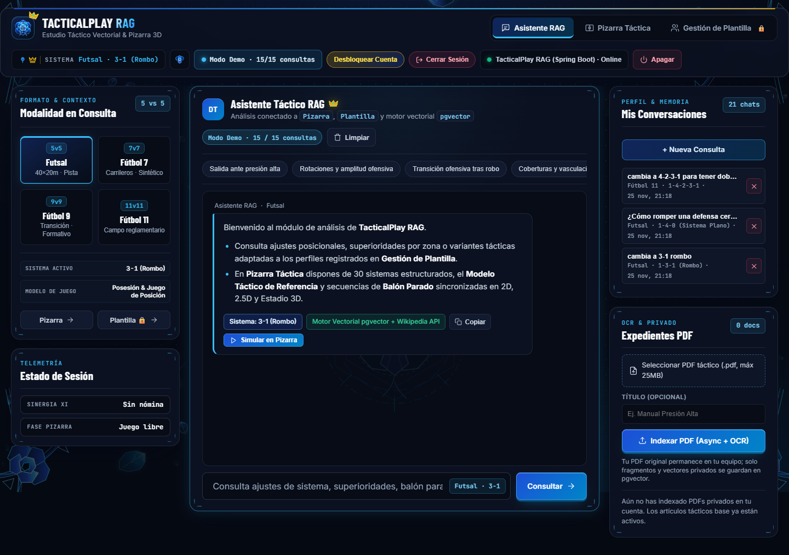
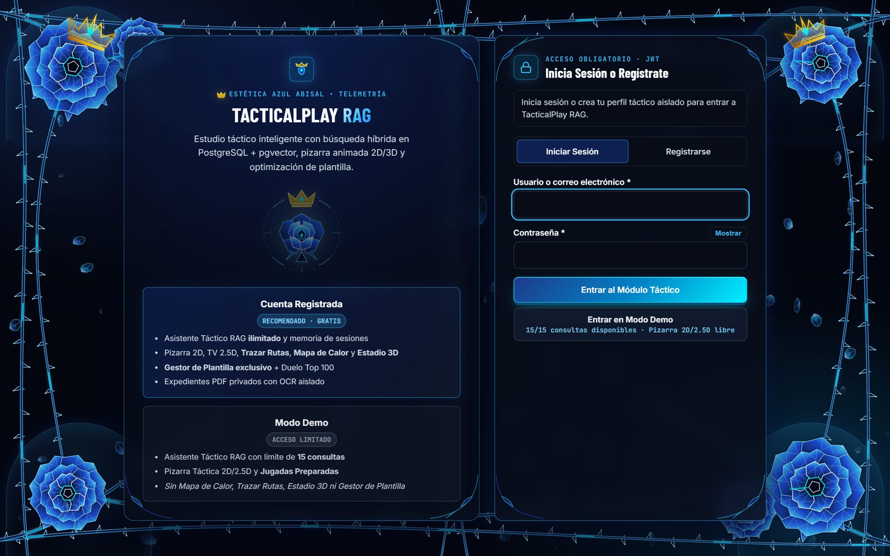
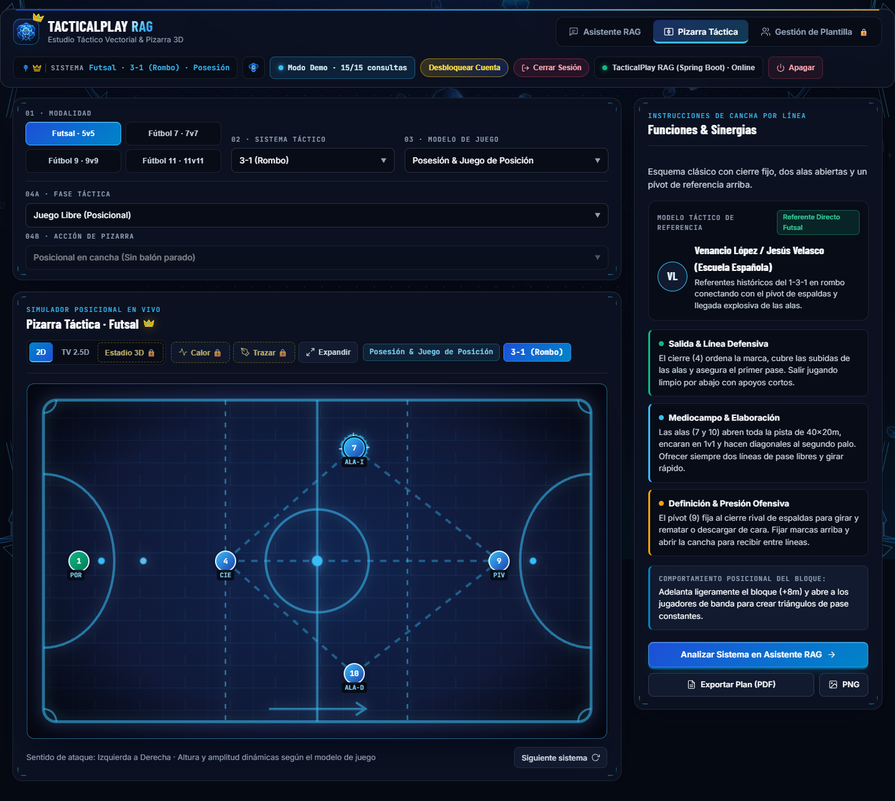

<div align="center">


<p>
  
  
  
  
  
  
</p>

<p>
  <strong>Plataforma interactiva de dirección técnica e inteligencia artificial para Futsal, Fútbol 7, Fútbol 9 y Fútbol 11.</strong><br/>
  Integra un asistente táctico con búsqueda híbrida (<code>pgvector</code> + Full-Text Search) sobre tus propios manuales en PDF, una pizarra animada en 2D / TV 2.5D / Estadio 3D y un optimizador de química colectiva para plantillas.
</p>

</div>

---

## 🎯 1. ¿Qué es TacticalPlay RAG? — Vista Previa

**TacticalPlay RAG** es un estudio táctico digital diseñado para entrenadores, analistas y cuerpos técnicos que necesitan llevar sus manuales, apuntes y conceptos de juego directamente a la cancha.

La aplicación permite conversar con un asistente especializado por modalidad deportiva, consultar literatura táctica propia en PDF con citas verificables por página y sección, modificar formaciones en tiempo real desde el chat, simular jugadas de balón parado en 2D/2.5D/3D y calcular el **XI Ideal** según los atributos y la sinergia de tu plantilla.

<div align="center">
  
  <br/>
  <sub><em>Estudio principal de TacticalPlay RAG: Asistente Táctico RAG con selector multideporte, telemetría de sesión, historial de conversaciones y biblioteca de Expedientes PDF privados.</em></sub>
</div>

<br/>

<div align="center">
  <table>
    <tr>
      <td align="center" width="50%">
        
        <br/>
        <sub><em>Portal de acceso con Estética Azul Abisal (Cuenta Registrada ilimitada y Modo Demo).</em></sub>
      </td>
      <td align="center" width="50%">
        
        <br/>
        <sub><em>Pizarra Táctica Interactiva con sistemas por modalidad, balón parado, Trazar Rutas y vistas 2D / TV 2.5D / Estadio 3D.</em></sub>
      </td>
    </tr>
  </table>
</div>

---

## 🧭 2. Guía de Uso de la Aplicación (Paso a Paso)

### 🔐 A. Acceso: Cuenta Registrada vs. Modo Demo
Al abrir la aplicación puedes elegir entre dos modalidades de ingreso:
- **Modo Demo (Acceso Rápido):** Permite explorar la interfaz de inmediato con una cuota de **15 consultas** al Asistente Táctico RAG y uso libre de la pizarra posicional en vistas **2D Cenital** y **TV 2.5D**.
- **Cuenta Registrada (Recomendado · Gratis):** Al crear tu usuario personal desbloqueas consultas ilimitadas al asistente, memoria persistente de conversaciones, subida privada de **Expedientes PDF con OCR**, **Trazar Rutas**, **Mapa de Calor Dinámico**, vista **Estadio 3D** y el módulo completo de **Gestión de Plantilla**.

### 🤖 B. Asistente Táctico RAG y Cambio Automático de Formación
1. **Elige la Modalidad en Consulta** en la columna izquierda: **Futsal (`5v5`)**, **Fútbol 7 (`7v7`)**, **Fútbol 9 (`9v9`)** o **Fútbol 11 (`11v11`)**.
2. **Realiza tu consulta táctica** usando lenguaje natural o los chips rápidos (salida ante presión alta, rotaciones ofensivas, transiciones tras robo, coberturas).
3. **Pídele al chat que cambie de formación en vivo:**
   - Si estás en un esquema (por ejemplo `4-0`) y escribes en el chat *"quiero probar una 1-2-1"*, *"cambia a 3-1 rombo"* o *"cambia a 4-2-3-1"*, el asistente adopta de inmediato la nueva formación como protagonista.
   - La aplicación **sincroniza automáticamente el sistema activo en toda la interfaz** (píldora superior, barra lateral, selector de la Pizarra Táctica y posición de las fichas en cancha), mostrando en la respuesta el badge **`Sistema actualizado a: <formación>`** junto al botón **`Simular en Pizarra`**.

### 📄 C. Expedientes PDF Privados (Async + OCR)
1. En la tarjeta **Expedientes PDF** (columna derecha del Asistente RAG), haz clic en **Seleccionar PDF táctico (`.pdf`, máx 25MB)**.
2. Opcionalmente asigna un título descriptivo (ej. *Manual Presión Alta*) y pulsa **`Indexar PDF (Async + OCR)`**.
3. El sistema procesa el documento en segundo plano (aplicando **OCR automático** si contiene páginas escaneadas) e indexa sus fragmentos y vectores de **768 dimensiones** de forma **100 % privada para tu cuenta**.
4. A partir de ese momento, el asistente responderá respaldado por tus propios manuales e incluirá citas trazables con nombre de archivo, página y sección (`[Manual.pdf (Pág. 4 · Sec: Salida Lavolpiana)]`).

### 🏟️ D. Pizarra Táctica (2D, TV 2.5D y Estadio 3D)
En la pestaña **Pizarra Táctica** dispones de un simulador interactivo adaptado a las dimensiones y reglas de cada deporte:
- **30 Sistemas Tácticos y 5 Modelos de Juego:** Cambia entre formaciones de Futsal (`3-1 Rombo`, `2-2 Cuadrado`, `4-0 Sistema Plano`, `1-2-1 Pirámide`, `2-1-1 Y Invertida`, `5-0 Portero-Jugador`), Fútbol 7, Fútbol 9 y Fútbol 11, observando cómo se ajustan las líneas y qué **DT Referente** representa esa idea táctica.
- **Movimiento Libre y Balón Parado:** Arrastra cualquier ficha sobre la cancha para ajustar ubicaciones o selecciona una jugada preparada (**Ataque** o **Defensa**) para reproducir sus movimientos paso a paso con animación GSAP.
- **Trazar Rutas conectada al RAG:** Activa el modo dibujo para trazar líneas de pase, conducciones o desmarques sobre la pizarra y envíalos con un clic al Asistente RAG para recibir retroalimentación táctica sobre tu jugada dibujada.
- **Mapa de Calor Dinámico y Cámaras:** Visualiza la ocupación espacial por carriles y tercios de cancha, alterna entre cámara **2D Cenital**, **TV 2.5D** y **Estadio 3D (Three.js)**, o exporta tu **Plan de Partido** listo para impresión/PDF.

### 👥 E. Gestión de Plantilla & Sinergia XI
En la pestaña **Gestión de Plantilla** puedes modelar tu propio equipo:
1. **Registra a tus jugadores** con nombre, dorsal, posición natural según el deporte, pie hábil y 6 atributos (`Ritmo`, `Pase`, `Regate`, `Defensa`, `Tiro` y `Visión`).
2. **Calcula el XI Ideal y la Sinergia Global:** Reordena titulares y suplentes mediante *Drag & Drop* o pulsa **`Generar Plantilla Ideal`** para que el motor optimice la alineación según la química colectiva y el estilo de juego activo.
3. **Radar Comparativo Top 100 y Exportación a Pizarra:** Selecciona cualquier jugador para comparar su radar hexagonal frente a leyendas y referentes del **Top 100**, y exporta tu alineación titular directamente a la **Pizarra Táctica**.

---

## 🏗️ 3. Tecnologías y Arquitectura (Vista de Alto Nivel)

| Capa | Tecnologías Principales |
| :--- | :--- |
| **Frontend & Visualización 3D** | **HTML5**, **CSS3** (estética *Estética Azul Abisal*), **JavaScript ES Modules**, **Vite 5**, **GSAP 3** (animación táctica 2D/2.5D), **Three.js** (renderizado de Estadio 3D) |
| **Backend & Seguridad** | **Java 21**, **Spring Boot 3** (`Spring Web`, `Spring Security` con autenticación **JWT**, `Spring JDBC`, `Validation`), **Apache PDFBox 3** |
| **Motor IA, RAG & OCR** | Búsqueda Híbrida **Reciprocal Rank Fusion (RRF)** combinando similitud coseno (`pgvector` **768d**) + Full-Text Search (`tsvector`), integración con **OpenAI** / **Google Gemini** / **Ollama Local** y pipeline **OCR (Tesseract / Vision)** |
| **Base de Datos Vectorial** | **PostgreSQL 16 + `pgvector`** con índices vectoriales **HNSW** (`vector_cosine_ops`) e índices léxicos **GIN** |

```text
+-----------------------------------------------------------------------------+
|                     FRONTEND — Vite + Vanilla JS ES Modules                 |
|   Asistente Táctico RAG   |   Pizarra 2D / TV 2.5D / 3D   |   Plantilla XI  |
+--------------------------------------+--------------------------------------+
                                       |
                                 HTTPS / JSON + JWT
                                       v
+-----------------------------------------------------------------------------+
|                       BACKEND — Java 21 + Spring Boot 3                     |
|   Controladores REST + Filtro JWT Stateless                                 |
|   ChatService (RAG Híbrido RRF + Cambio de Formación en Vivo)               |
|   PdfIngestionService + AsyncPdfProcessor (PDFBox + OCR Asíncrono)          |
|   TopPlayersApiService (Motor de Sinergia Colectiva + Comparador Top 100)   |
+-------------------+-------------------------------------+-------------------+
                    |                                     |
       Embeddings / Chat / OCR                            | Consultas Vectoriales + FTS
                    v                                     v
+---------------------------------------+   +---------------------------------+
|       Proveedores de IA y OCR         |   |    PostgreSQL 16 + pgvector     |
|  - OpenAI / Google Gemini / Ollama    |   |  - Vectores 768d (Índice HNSW)  |
|  - Motor OCR para PDFs escaneados     |   |  - Full-Text Search (tsvector)  |
|  - Base táctica de conocimiento       |   |  - Aislamiento por usuario      |
+---------------------------------------+   +---------------------------------+
```

---

## 🚀 4. Instalación Rápida

### Requisitos Previos
- **JDK 21+** y **Apache Maven 3.9+**
- **Node.js 18+** y **npm**
- **PostgreSQL 16** con la extensión **`pgvector`** (o **Docker Desktop**)
- Una clave de API de **OpenAI** o **Google Gemini** (o **Ollama** ejecutándose localmente)

### 1. Clonar el Repositorio y Configurar Variables de Entorno
```bash
git clone https://github.com/DanielGamboa-10/Tactical_Rag.git
cd Tactical_Rag
cp .env.example .env
```

Edita el archivo `.env` con tus propios valores:
```env
AI_EMBEDDING_PROVIDER=auto
AI_CHAT_PROVIDER=auto

OPENAI_API_KEY=<tu_api_key_de_openai>
GEMINI_API_KEY=<tu_api_key_de_gemini>
JWT_SECRET=<tu_clave_secreta_jwt_de_al_menos_32_caracteres>

POSTGRES_USER=<tu_usuario_postgres>
POSTGRES_PASSWORD=<tu_password_postgres>
POSTGRES_DB=<tu_base_de_datos>
SPRING_DATASOURCE_URL=jdbc:postgresql://localhost:5432/<tu_base_de_datos>
```

### 2. Iniciar Base de Datos y Backend
```bash
# Si utilizas Docker Compose para levantar PostgreSQL + pgvector:
docker compose up -d

# Iniciar el servidor backend Spring Boot:
mvn spring-boot:run
```

### 3. Iniciar el Frontend
```bash
cd frontend
npm install
npm run dev
```

Abre la URL local indicada por Vite en tu navegador para comenzar a usar **TacticalPlay RAG**.

---

## 👨‍💻 5. Autor

**Daniel Eduardo Jaimes Gamboa** (`@DanielGamboa-10`)  
*AI Engineer & Full-Stack Software Developer*  
Floridablanca / Bucaramanga, Santander, Colombia  
GitHub: [https://github.com/DanielGamboa-10](https://github.com/DanielGamboa-10)
